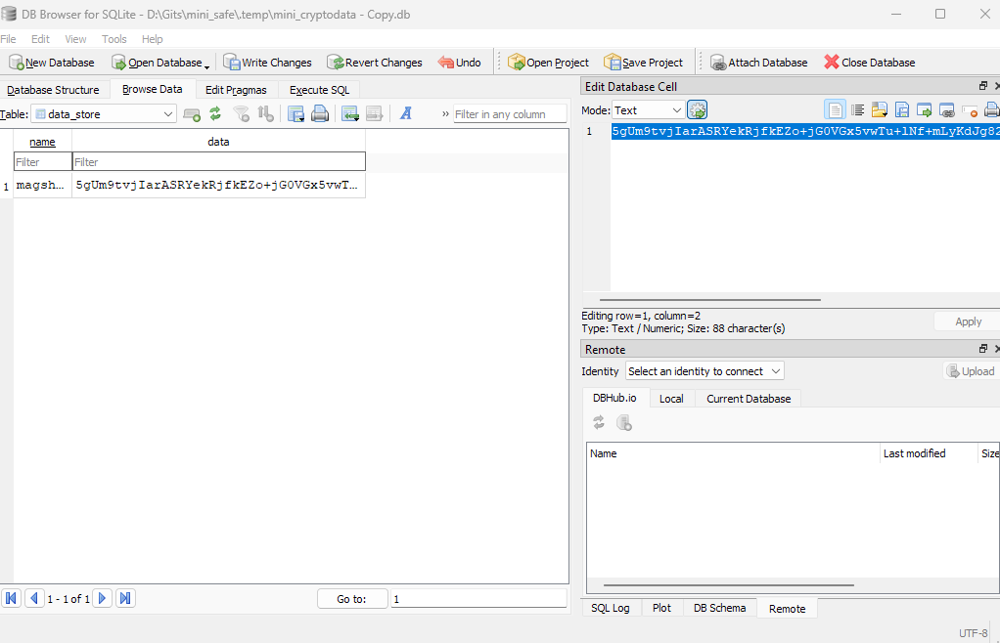
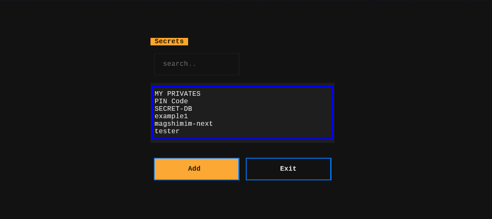

<div align="center">
  
  # Mini Safe

A small, simple Python project for securely storing and managing sensitive data using password-based encryption. Built with industry-standard cryptography libraries to provide confidentiality for your data at rest.


<br>


</div>

## Overview

`mini_safe` is a lightweight utility designed to help you encrypt and store sensitive information (passwords, API keys, personal data, etc.) securely. It uses password-based key derivation and modern encryption algorithms to protect your data.

## Features

✨ **Password-Based Encryption** - Encrypt sensitive data using only a password  
🔐 **Industry-Standard Cryptography** - Built on proven libraries (cryptography, bcrypt)  
🎯 **Lightweight** - Minimal dependencies and simple API  
📦 **Easy Integration** - Use it as a library or standalone tool  
🛡️ **Secure by Default** - Uses best practices for data protection  

## How data is protected
> Using AESGCM encryption, the data is encrypted with a key derived from the user's password.
<br><br>


## Requirements

- Python 3.10+
- Dependencies listed in `requirements.txt`:

## Installation

1. Clone the repository:
   ```bash
   git clone https://github.com/nadav26740/mini_safe.git
   cd mini_safe
   ```

2. Install dependencies:
   ```bash
   pip install -r requirements.txt
   ```

3. Run the TUI application:
   ```bash
   python -m TUI_main
   ```

## Building packages

### Python wheel and source distribution

Build the Python package artifacts locally:

```bash
python -m pip install --upgrade build
python -m build
```

Artifacts will be written to the dist directory.

## Debian package

> The repository includes a Debian packaging scaffold for Debian 12 / Ubuntu 24.04 style builds.

1. Install packaging dependencies:
   ```bash
   sudo apt update
   sudo apt install -y devscripts debhelper dh-python python3-all python3-build python3-setuptools python3-wheel
   ```

2. Build the Debian package from the repository root:
   ```bash
   dpkg-buildpackage -us -uc
   ```

3. Install the resulting Debian package:
   ```bash
   sudo dpkg -i ../mini-safe_1.0.0-1_all.deb
   ```

## Fedora package

> The repository includes a Fedora spec file for RPM builds.

1. Install Fedora packaging tools:
   ```bash
   sudo dnf install -y rpmdevtools rpmbuild python3-devel python3-setuptools python3-wheel
   ```

2. Prepare the build tree:
   ```bash
   rpmdev-setuptree
   cp dist/mini_safe-1.0.0.tar.gz ~/rpmbuild/SOURCES/
   cp packaging/fedora/mini-safe.spec ~/rpmbuild/SPECS/
   ```

3. Build the RPM:
   ```bash
   rpmbuild -ba ~/rpmbuild/SPECS/mini-safe.spec
   ```

4. Install the resulting RPM:
   ```bash
   sudo dnf install -y ~/rpmbuild/RPMS/noarch/mini-safe-1.0.0-1.noarch.rpm
   ```

## Running the application

After installation, use:

```bash
mini-safe
```

To run the CLI interface directly:

```bash
mini-safe-cli
```

## Usage

_Usage examples and API documentation coming soon._
> * run ``python src/cli_main.py`` for the normal run
> * run ``python src/tui_main.py`` for the TUI mode

### TUI


## Project Structure

```
mini_safe/
├── src/              # Source code
├── requirements.txt  # Python dependencies
├── LICENSE          # Apache 2.0 License
├── .gitignore       # Git ignore rules
└── README.md        # This file
```

## License

This project is licensed under the [Apache License 2.0](LICENSE).

## Contributing

Contributions are welcome! Feel free to submit issues and pull requests.

## Author

Created by [nadav26740](https://github.com/nadav26740)

---

**Note:** This project is designed for sensitive data management. Ensure you understand the security implications before using it with critical information.
